# Percobaan Simulasi Algoritma Bat dan Firefly dengan CloudSim

Komparasi performa **Bat Algorithm (BA)** dan **Firefly Algorithm (FA)** dengan pembanding **PSO** dan **Min-Min** untuk penjadwalan task independen di **CloudSim 3.0.3**, menggunakan workload nyata dataset **GoCJ (Google Cloud Jobs)**.

## Kelompok 04

| Nama | NRP |
|---|---|
| Thio Billy Amansyah | 5027231007 |
| Putri Joselina Silitonga | 5027241116 |
| Muhammad Khairul Yahya | 5027241092 |
| Nabilah Anindya Paramesti | 5027241006 |
| Zahra Hafizhah | 5027241121 |

## Daftar Isi

1. [Ringkasan Percobaan](#1-ringkasan-percobaan)
2. [Arsitektur Infrastruktur Cloud](#2-arsitektur-infrastruktur-cloud)
3. [Implementasi Algoritma](#3-implementasi-algoritma)
4. [Fungsi Objektif dan Metrik](#4-fungsi-objektif-dan-metrik)
5. [Skenario Percobaan](#5-skenario-percobaan)
6. [Hasil Percobaan CloudSim](#6-hasil-percobaan-cloudsim)
7. [Bukti Eksekusi Program](#7-bukti-eksekusi-program)
8. [Analisis dan Kesimpulan](#8-analisis-dan-kesimpulan)
9. [Struktur Folder](#9-struktur-folder)
10. [Cara Menjalankan](#10-cara-menjalankan)
11. [Referensi](#11-referensi)

---

## 1. Ringkasan Percobaan

Proyek simulasi penjadwalan cloud data center ini bertujuan membandingkan dan mengevaluasi performa algoritma metaheuristik **Bat Algorithm (BA)** dan **Firefly Algorithm (FA)**, dengan **PSO** dan **Min-Min** sebagai pembanding, dalam menjadwalkan task independen berbasis workload nyata dataset **GoCJ**.

Fungsi objektif yang dioptimasi adalah kombinasi linear **Makespan** (waktu penyelesaian task terakhir) dan **Degree of Imbalance (DI)** untuk menyeimbangkan beban antar mesin, dengan bobot preferensi **w = 0.7** terhadap makespan.

Infrastruktur simulasi terdiri dari **30 host** (masing-masing 4 PE, 4000 MIPS, RAM 16 GB) dan **50 Virtual Machine** dengan kapasitas MIPS heterogen (500, 1000, dan 2000 MIPS).

Pengujian dilakukan lewat tiga skenario:

- **E1**: inisialisasi acak murni (menguji eksplorasi).
- **E2**: hibrida, solusi Min-Min disisipkan ke populasi awal (menguji fine-tuning).
- **E4**: skalabilitas jumlah task dari 100 sampai 1000.

Hasil analitik divalidasi terhadap engine **CloudSim 3.0.3**, lalu diekspor menjadi CSV dan grafik komparasi.

## 2. Arsitektur Infrastruktur Cloud

Arsitektur dibuat hierarkis dua tingkat (host fisik dan VM heterogen) dan dikelola dengan CloudSim 3.0.3.

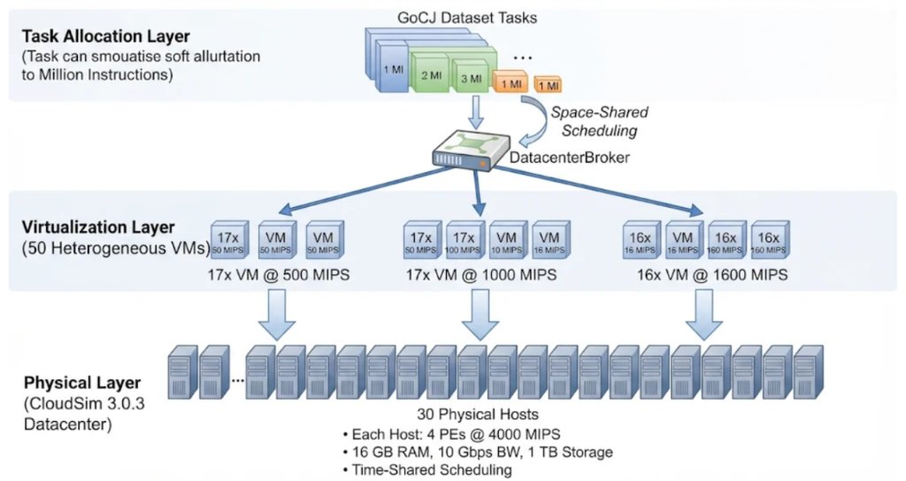

| Lapisan | Detail | Berkas |
|---|---|---|
| **Fisik** | 30 host, masing-masing 4 PE @ 4000 MIPS, RAM 16 GB, bandwidth 10 Gbps, storage 1 TB, penjadwalan *time-shared* | `sim/CloudSimRunner.java` |
| **Virtualisasi** | 50 VM heterogen: 17 VM @ 500 MIPS, 17 VM @ 1000 MIPS, 16 VM @ 2000 MIPS (1 PE per VM), dialokasikan dengan `VmAllocationPolicySimple()` | `model/Problem.java`, `sim/CloudSimRunner.java` |
| **Alokasi task** | `DatacenterBroker` memetakan task independen GoCJ (satuan MI) ke antrean VM dengan penjadwalan *space-shared* | `sim/CloudSimRunner.java` |

## 3. Implementasi Algoritma

| Algoritma | Peran | Representasi | Berkas |
|---|---|---|---|
| Bat Algorithm (BA) | Utama | Diskret: vektor indeks VM per task | `algorithm/BatScheduler.java` |
| Firefly Algorithm (FA) | Utama | Diskret, jarak Hamming | `algorithm/FireflyScheduler.java` |
| PSO | Pembanding | Kontinu `[0, m)`, decode dengan `floor` | `algorithm/PsoScheduler.java` |
| Min-Min | Baseline heuristik | Deterministik | `algorithm/MinMin.java` |

**Parameter** (dari `algorithm/AlgorithmParams.java`):

| Kelompok | Parameter | Nilai |
|---|---|---|
| Bersama | Ukuran populasi | 30 |
| Bersama | Budget evaluasi | 100 × jumlah task (50.000 untuk 500 task) |
| Bersama | Bobot fitness w | 0.7 |
| Bersama | Seed acak | 42 |
| FA | β0, γ, α0 | 1.0, 1.0, 0.01 (α turun 10× di akhir run) |
| BA | f_max, A0, r0, α, γ, k_max | 0.5, 0.9, 0.5, 0.9, 0.9, 2% jumlah task |
| PSO | w (awal→akhir), c1, c2, v_max | 0.9→0.4, 2.0, 2.0, 0.5 × jumlah VM |

## 4. Fungsi Objektif dan Metrik

**Fitness yang diminimalkan** (sesuai `model/FitnessEvaluator.java`):

```text
F = w · (Makespan / MakespanRef) + (1 − w) · DI        dengan w = 0.7
```

Metrik yang dilaporkan:

1. **Makespan**: waktu penyelesaian maksimal di antara seluruh VM.
   `Makespan = max( FinishTime(vm_j) ), j = 1..m`
2. **Degree of Imbalance (DI)**: ketidakseimbangan beban antar VM.
   `DI = (Tmax − Tmin) / Tavg`
3. **Resource Utilization**: total waktu eksekusi aktual dibanding kapasitas total makespan.
   `Resource Utilization = ( Σ TotalExecTime_j ) / ( m × Makespan )`

Metrik tambahan: **Lower Bound** (total MI / total MIPS), **Gap** terhadap Lower Bound, rata-rata waktu eksekusi, waktu tunggu, turnaround, throughput, dan simpangan baku waktu selesai antar VM.

## 5. Skenario Percobaan

| Skenario | Deskripsi |
|---|---|
| **E1** | BA, FA, PSO mulai dari populasi acak murni |
| **E2** | Solusi Min-Min disisipkan ke populasi awal BA, FA, PSO |
| **E4** | Skalabilitas: dataset GoCJ 100, 300, 500, 600, 800, 1000 task |

## 6. Hasil Percobaan CloudSim

Data lengkap ada di folder [`results/`](results/).

### 6.1 Perbandingan E1 vs E2

Sumber: `results/e1_vs_e2_comparison.csv`. Inisialisasi hibrida (E2) mengungguli inisialisasi acak (E1) pada seluruh algoritma metaheuristik.

| Algoritma | Makespan E1 (s) | Makespan E2 (s) | Peningkatan (%) | DI E1 | DI E2 | Util E1 (%) | Util E2 (%) |
|---|---:|---:|---:|---:|---:|---:|---:|
| BA | 2428 | 1275 | 47.49 | 1.2238 | 0.2012 | 63.02 | 92.47 |
| FA | 1527 | 1218 | 20.24 | 0.4781 | 0.1060 | 82.19 | 93.92 |
| PSO | 2801.5 | 1552 | 44.60 | 1.7512 | 1.0617 | 51.18 | 61.54 |
| Min-Min | 1592.25 | 1592.25 | 0 | 1.1350 | 1.1350 | 58.78 | 58.78 |

- BA turun dari 2428 s menjadi 1275 s (**47,49%**), FA dari 1527 s menjadi 1218 s (**20,24%**).
- DI BA turun dari 1,2238 menjadi 0,2012, DI FA dari 0,4781 menjadi 0,1060.
- Utilisasi sumber daya BA dan FA pada E2 melampaui 92%.

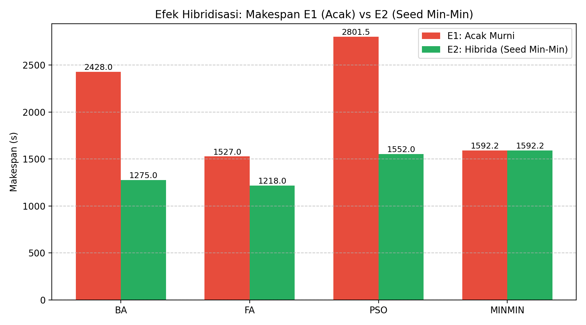

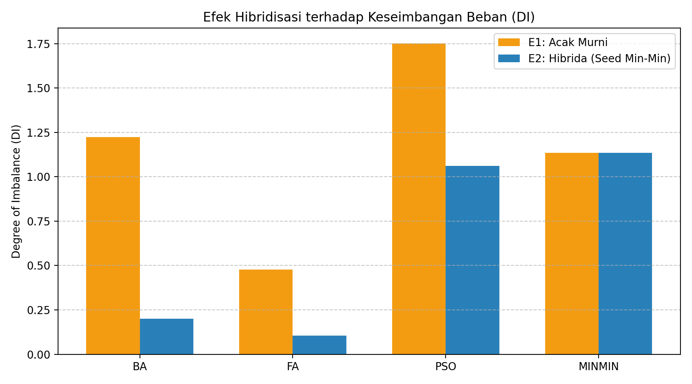

### 6.2 Metrik Ringkasan

Sumber: `results/summary_metrics.csv`. Dataset 500 task, Lower Bound = 1130,46 s.

| Algoritma | Makespan | Gap (%) | Avg Exec | Avg Wait | Avg Turnaround | Util (%) | DI | Throughput | Std VM Finish |
|---|---:|---:|---:|---:|---:|---:|---:|---:|---:|
| BA (E1 Acak) | 2428 | 114.78 | 153.01 | 748.08 | 901.08 | 63.02 | 1.2238 | 0.2059 | 794.17 |
| FA (E1 Acak) | 1527 | 35.08 | 125.50 | 540.89 | 666.39 | 82.19 | 0.4781 | 0.3274 | 242.54 |
| PSO (E1 Acak) | 2801.5 | 147.82 | 143.39 | 723.38 | 866.77 | 51.18 | 1.7512 | 0.1785 | 794.56 |
| BA (E2 Hibrida) | 1275 | 12.79 | 117.89 | 522.66 | 640.55 | 92.47 | 0.2012 | 0.3922 | 96.66 |
| **FA (E2 Hibrida)** | **1218** | **7.74** | 114.40 | **510.06** | 624.46 | **93.92** | **0.1060** | **0.4105** | **38.28** |
| PSO (E2 Hibrida) | 1552 | 37.29 | 95.50 | 522.50 | 618.00 | 61.54 | 1.0617 | 0.3222 | 373.43 |
| Min-Min | 1592.25 | 40.85 | 93.59 | 530.59 | 624.18 | 58.78 | 1.1350 | 0.3140 | 394.58 |

**FA E2 (Hibrida)** mencatat makespan terendah (1218 s), waktu tunggu rata-rata terendah, throughput tertinggi (0,4105 task/detik), utilisasi tertinggi (93,92%), serta DI terendah (0,1060) dengan simpangan baku waktu selesai VM 38,28 s.

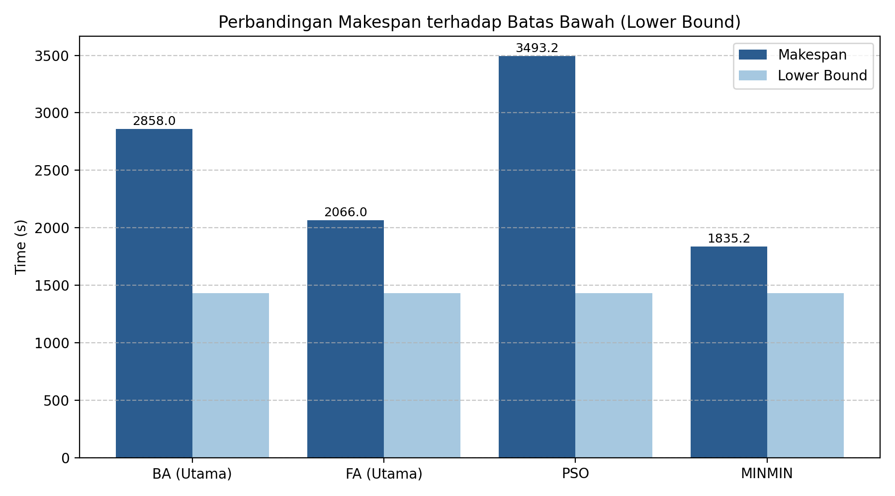

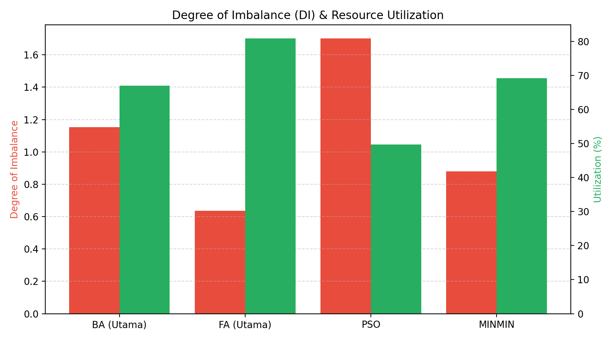

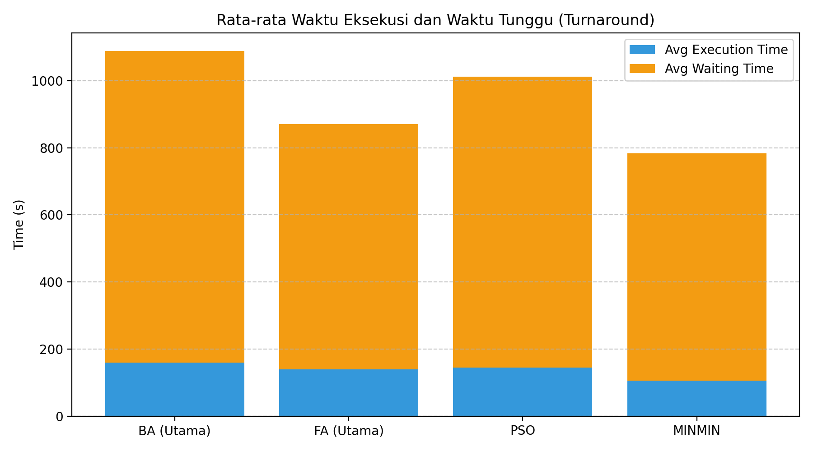

### 6.3 Skalabilitas E4

Sumber: `results/scale_metrics.csv`. Makespan (detik) dan Gap terhadap Lower Bound (%), inisialisasi acak, seed 42.

| Task | Lower Bound | BA | BA Gap | FA | FA Gap | PSO | PSO Gap | Min-Min | Min-Min Gap |
|---:|---:|---:|---:|---:|---:|---:|---:|---:|---:|
| 100 | 234.95 | 1050 | 346.91 | 748 | 218.37 | 582.25 | 147.82 | 620 | 163.89 |
| 300 | 722.19 | 1809 | 150.49 | 1505 | 108.39 | 1814.5 | 151.25 | 1218 | 68.65 |
| 500 | 1130.46 | 2428 | 114.78 | 1527 | 35.08 | 2801.5 | 147.82 | 1592.25 | 40.85 |
| 600 | 1432.02 | 2858 | 99.58 | 2066 | 44.27 | 3493.25 | 143.94 | 1835.25 | 28.16 |
| 800 | 1721.01 | 3596 | 108.95 | 2340 | 35.97 | 4685 | 172.22 | 2093.75 | 21.66 |
| 1000 | 2254.99 | 4802 | 112.95 | 2896 | 28.43 | 5345 | 137.03 | 2778 | 23.19 |

Lower Bound teoretis naik dari 234,95 s (100 task) menjadi 2254,99 s (1000 task), dan makespan tumbuh kurang lebih proporsional dengan jumlah task.

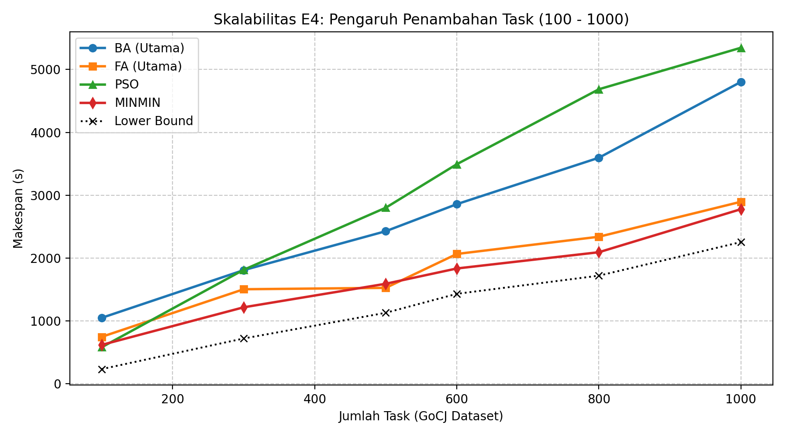

## 7. Bukti Eksekusi Program

**7.1 Kompilasi dan menjalankan `MetricExtractor`**

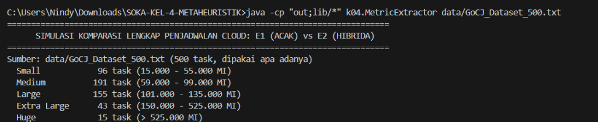

**7.2 Output metrik E1 dan E2 di terminal**

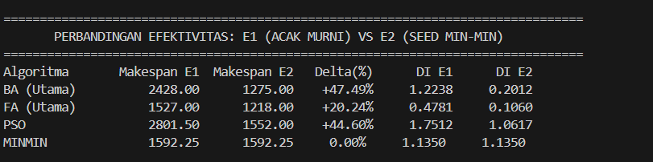

**7.3 Validasi CloudSim (selisih analitik vs CloudSim)**

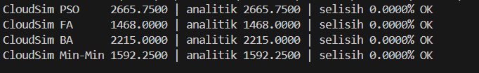

**7.4 File hasil yang terbentuk di `results/`**

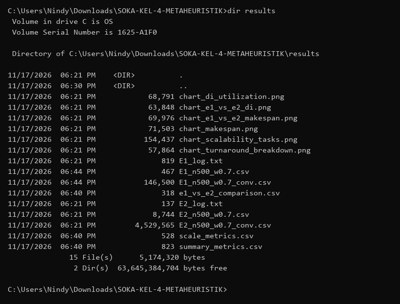

## 8. Analisis dan Kesimpulan

1. **Hibridisasi sangat membantu.** Dengan seed Min-Min (E2), BA dan FA turun jauh dari E1 dan melampaui Min-Min. Metaheuristik efektif sebagai *fine-tuner* solusi awal yang sudah baik.
2. **FA paling baik secara keseluruhan** pada dataset 500 task: makespan, DI, utilisasi, dan throughput terbaik pada mode E2.
3. **BA sensitif terhadap inisialisasi.** Pada E1 hasilnya buruk (makespan 2428 s), tetapi pada E2 membaik 47,49%.
4. **Skalabilitas.** Di antara BA, FA, dan PSO pada inisialisasi acak, FA umumnya punya gap terendah untuk 300 sampai 1000 task (28,43% pada 1000 task). Pada 100 task PSO lebih baik. Min-Min tanpa seed justru lebih baik dari FA pada 300, 600, 800, dan 1000 task.
5. **Utilisasi PSO tetap rendah** (sekitar 61% pada E2), tanda PSO diskret ini kurang efektif memperbaiki keseimbangan beban.
6. **Keterbatasan.** Hasil memakai seed 42 (satu run) sehingga belum ada rata-rata dari beberapa run, dan eksperimen hanya memakai dataset GoCJ dengan satu konfigurasi infrastruktur.

## 9. Struktur Folder

```text
.
├── data/                      # Dataset GoCJ (100 sampai 1000 task)
├── docs/screenshots/          # Screenshot eksekusi dan gambar arsitektur
├── lib/cloudsim-3.0.3.jar     # Library CloudSim
├── results/                   # Output CSV dan grafik (PNG)
├── scripts/
│   ├── run_metric_extractor.sh   # Compile, run simulasi, buat grafik
│   ├── demo.sh                   # Script demo
│   └── plot_results.py           # Pembuat grafik
├── src/main/java/k04/
│   ├── algorithm/             # BatScheduler, FireflyScheduler, PsoScheduler, MinMin
│   ├── dataset/               # GoCJLoader
│   ├── model/                 # Problem, FitnessEvaluator, ScheduleMetrics
│   ├── sim/                   # CloudSimRunner
│   ├── MetricExtractor.java   # Ekstraktor metrik dan evaluasi
│   └── Runner.java            # Runner eksperimen
└── pom.xml
```

## 10. Cara Menjalankan

**Kebutuhan:** Java JDK 17 (atau Java 8+) dan Python 3.

```bash
pip install pandas matplotlib
```

**Cara cepat** (compile, run E1/E2/E4, ekspor CSV, buat grafik):

```bash
./scripts/run_metric_extractor.sh
```

Dataset lain, misalnya 1000 task:

```bash
./scripts/run_metric_extractor.sh data/GoCJ_Dataset_1000.txt
```

**Cara manual:**

```bash
# 1. Kompilasi
javac -cp "lib/*" -d out $(find src/main/java -name "*.java")

# 2. Jalankan ekstraktor metrik
java -cp "out:lib/*" k04.MetricExtractor data/GoCJ_Dataset_500.txt

# 3. Buat grafik
python3 scripts/plot_results.py
```

> Pengguna Windows: ganti `out:lib/*` menjadi `out;lib/*`.

## 11. Referensi

1. Yousif, A., Abdullah, A. H., Nor, S. M., & Abdelaziz, A. A. (2011). *Scheduling jobs on grid computing using firefly algorithm*. Journal of Theoretical and Applied Information Technology, 33(2). https://www.jatit.org/volumes/Vol33No2/3Vol33No2.pdf
2. Raghavan, S., Sarwesh, P., Marimuthu, C., & Chandrasekaran, K. (2015). *Bat algorithm for scheduling workflow applications in cloud*. IEEE. https://ieeexplore.ieee.org/document/7060555
3. Hussain, A., & Aleem, M. (2018). GoCJ: Google Cloud Jobs dataset for distributed and cloud computing infrastructures. *Data*, 3(4), 38.
4. Calheiros, R. N., et al. (2011). CloudSim: a toolkit for modeling and simulation of cloud computing environments. *Software: Practice and Experience*, 41(1).
